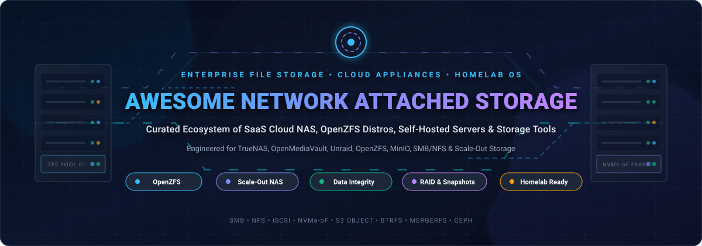
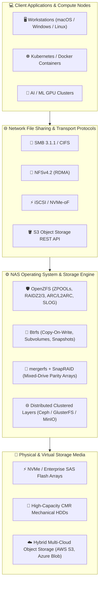

  

<h1 align="center">💾 Awesome Network Attached Storage (NAS) 🗄️</h1>

  <strong>Curated ecosystem of enterprise cloud NAS platforms, OpenZFS distributions, self-hosted file servers, homelab operating systems, and high-performance storage tools.</strong>

  
  
  
  
  
  

---

## 📌 Overview & Storage Architecture

**Network Attached Storage (NAS)** delivers centralized, network-accessible data storage enabling multiple heterogeneous clients and workloads to store, retrieve, and replicate files seamlessly. Modern NAS stacks bridge enterprise multi-petabyte scale-out appliances with private, self-hosted homelab operating systems powered by copy-on-write filesystems such as **OpenZFS** and **Btrfs**.

Whether safeguarding multimedia archives, providing shared persistent volumes for Kubernetes clusters, serving ultra-low-latency NVMe-oF data to compute nodes, or preventing bit-rot with continuous cryptographic data scrubbing, this index tracks the gold standards in hosted SaaS solutions and community open-source repositories.

---

## 📑 Table of Contents

- [📊 Sector Overview & Market Dynamics](#-sector-overview--market-dynamics)
- [🏢 SaaS & Commercial Hosted Platforms](#-saas--commercial-hosted-platforms)
- [💻 Open-Source GitHub Projects](#-open-source-github-projects)
- [🛠️ Specialized Non-GitHub & Proprietary Appliances](#️-specialized-non-github--proprietary-appliances)
- [🏗️ Architectural Buyer's Matrix](#️-architectural-buyers-matrix)
- [🤝 How to Contribute](#-how-to-contribute)
- [💖 Support & Sponsorship](#-support--sponsorship)
- [📈 Star History](#-star-history)
- [📜 Disclaimer](#-disclaimer)

---

## 📊 Sector Overview & Market Dynamics

The global Network Attached Storage (NAS) market was valued at approximately **$31.5 billion in 2024–2025** and is projected to surpass **$85 billion by 2030–2032**, expanding at a robust compound annual growth rate (**CAGR of 16.8% to 19.2%**), driven by surging unstructured AI training data, real-time 8K video production workflows, hybrid multi-cloud mobility, and stringent enterprise requirements for immutable ransomware-proof snapshots.

The sector exhibits a **bifurcated market structure**: the enterprise tier is **moderately concentrated** among entrenched hardware and hyperscaler storage giants (Dell Technologies, NetApp, Pure Storage, AWS, Microsoft Azure), who command a high-margin enterprise oligopoly; conversely, the SMB, edge, and prosumer/homelab tiers are **highly fragmented** across turn-key appliance leaders (Synology, QNAP) and dominant open-source storage platforms (OpenZFS, TrueNAS, OpenMediaVault, Unraid, CasaOS). This dynamic prevents a winner-take-all outcome and ensures long-term coexistence between proprietary hyperscale SaaS services and sovereign, self-hosted open-source deployments.

---

## 🏢 SaaS & Commercial Hosted Platforms

The following enterprise cloud NAS, software-defined storage, and managed cloud file services deliver petabyte-scale throughput, cross-region replication, and compliance-grade data integrity.

> *Sorted descending by company size (Revenue / Market Capitalization / Valuation).*

| Product | Company Size & Valuation | Focus & Core Capabilities | Starting Pricing | Free Tier / Free Trial Limits |
| :--- | :--- | :--- | :--- | :--- |
| **[Dell PowerScale (OneFS / APEX File Storage)](https://www.dell.com/en-us/dt/storage/powerscale.htm)** | **~$102B+** Annual Revenue • **~$95B** Market Cap *(NYSE: DELL)* | Scale-out unstructured file data platform powered by OneFS, offering native multi-protocol access (NFS, SMB, S3, HDFS) for genomics, generative AI training, and petabyte-scale enterprise analytics. | Starting at **~$640/TB/year** (~$0.053/GB-mo) base software capacity licensing via AWS/Azure Marketplace (excluding underlying cloud VM/EBS infrastructure). | **90-day evaluation trial license** available via Dell APEX Navigator for Multicloud Storage (underlying cloud IaaS billed by cloud provider). |
| **[NetApp ONTAP / Cloud Volumes ONTAP](https://www.netapp.com/cloud-services/cloud-volumes-ontap/)** | **~$6.2B** Annual Revenue • **~$26B** Market Cap *(NASDAQ: NTAP)* | Enterprise-grade software-defined storage running ONTAP on AWS, Azure, and Google Cloud with native deduplication, compression, SnapMirror replication, and FlexCache acceleration. | Starting at **~$0.10/GB-month** (or **~$0.55/hour** PAYGO for Essentials single-node on AWS/Azure Marketplace; Professional HA starting at ~$1.10/hour). | **Freemium plan free forever up to 500 GB** provisioned storage capacity (zero software charges; cloud IaaS applies); or **30-day free trial** for capacity-based tiers on cloud marketplaces. |
| **[Pure Storage FlashBlade / Evergreen//One](https://www.purestorage.com/products/file-and-object/flashblade.html)** | **~$3.2B** Annual Revenue • **~$18B** Market Cap *(NYSE: PSTG)* | All-flash scale-out unified file and object platform built on Purity//FB, engineered for AI training clusters, rapid ransomware recovery, and high-concurrency analytics. | Starting at **~$0.20/GB effective acquisition** on FlashBlade//E (or STaaS subscription starting at **~$1,200/month** base commitment under 3-year Evergreen//One SLA). | **No free forever plan**; provides **Pure Test Drive** (interactive, zero-cost cloud virtual sandbox labs) plus **30-to-60 day on-premise Proof-of-Concept (PoC)** evaluation hardware loaner upon sales approval. |
| **[QNAP QuTScloud](https://www.qnap.com/solution/qutscloud/)** | **~$650M** Annual Revenue • Global Private NAS Hardware & Virtualization Titan | Virtual NAS appliance bringing QNAP QTS/QuTS hero OS to cloud hypervisors (AWS, Azure, GCP, VMware ESXi), featuring ZFS data integrity, Snapshot Replica, and App Center. | Starting at **$4.99/month** (or **$49.99/year**) for 1 CPU Core; **$9.99/month** for 2 Cores; **$14.99/month** for 4 Cores via QNAP Software Store. | **No free forever OS plan**; offers **Live Browser Interactive Demo** environment and **30-day free trial** for companion HDP SaaS cloud backup services (up to 1,000 users). |
| **[LucidLink Filespaces](https://www.lucidlink.com/)** | **~$400M** Valuation *(Series C, $75M Raised)* • **~$30M** ARR | Cloud-native file system providing immediate, zero-download streaming access to central cloud storage as a local mount point for creative video editors and distributed teams. | **$7.00 per member / month** (Starter plan; includes 100 GB pooled storage per user, up to 10 members and 1 TB team storage; Business tier at $27/member/mo with 400 GB/user). | **30-day free trial** with full platform capabilities, capped at **1 TB pooled storage, 10 team members, and 1 filespace**. |
| **[TrueNAS Enterprise (iXsystems)](https://www.truenas.com/enterprise-storage/)** | **~$120M** Annual Revenue • Leading Bootstrapped Open Storage Leader | Turnkey high-availability dual-controller storage appliances (H-Series, R-Series, F-Series NVMe) built on OpenZFS, offering non-disruptive failover, Fibre Channel, and 24/7 enterprise SLAs. | Turnkey enterprise hardware appliances start at **under $10,000** (H-Series dual-controller with Bronze Enterprise Support bundled; no per-TB software licensing fees). | **TrueNAS SCALE / Community Edition is 100% Free Forever** (unlimited raw capacity on custom hardware); plus **TrueNAS Connect free Foundation tier** for cloud fleet monitoring. |

---

## 💻 Open-Source GitHub Projects

The following active open-source projects deliver the foundations for self-hosted NAS servers, unified disk arrays, object storage backends, and storage administration consoles.

> *Sorted descending by repository GitHub stars count.*

| Project | GitHub Stars | Primary Language | Storage Focus & Architecture |
| :--- | :--- | :--- | :--- |
| **[MinIO](https://github.com/minio/minio)** |  | Go | High-performance, S3-compatible enterprise object storage suite designed for high-density private cloud and NAS deployments. |
| **[Rclone](https://github.com/rclone/rclone)** |  | Go | The "Swiss Army knife" of cloud and local storage synchronization, mounting remote object stores, WebDAV, SFTP, and NAS protocols locally. |
| **[CasaOS](https://github.com/IceWhaleTech/CasaOS)** |  | Go / Vue | Elegant, lightweight community-driven home cloud OS designed around Docker containers, smart file storage, and DIY NAS hardware. |
| **[Nextcloud Server](https://github.com/nextcloud/server)** |  | PHP / JavaScript | Enterprise-grade self-hosted collaboration platform, syncing files, calendars, and documents with end-to-end encryption on private NAS servers. |
| **[Ceph](https://github.com/ceph/ceph)** |  | C++ / Python | Highly scalable distributed storage system providing unified object (RADOS), block (RBD), and POSIX-compliant file storage (CephFS) across hardware clusters. |
| **[Seafile](https://github.com/haiwen/seafile)** |  | C / Python | Ultra-fast open-source file synchronization and sharing platform with block-level deduplication, client-side encryption, and built-in virtual drives. |
| **[Cockpit](https://github.com/cockpit-project/cockpit)** |  | C / JavaScript | Interactive Linux server administration dashboard with rich graphical plugins for storage pool creation, RAID, LUKS encryption, and NFS/Samba share configuration. |
| **[OpenZFS](https://github.com/openzfs/zfs)** |  | C | Advanced copy-on-write filesystem and logical volume manager powering modern NAS, featuring continuous checksumming, RAIDZ, fast snapshots, and native encryption. |
| **[OpenMediaVault](https://github.com/openmediavault/openmediavault)** |  | PHP / Python | Next-generation Debian-based NAS solution featuring out-of-the-box support for SMB, NFS, FTP, rsync, software RAID, and an extensible community plugin system. |
| **[mergerfs](https://github.com/trapexit/mergerfs)** |  | C++ | Feature-rich union filesystem (FUSE) that pools multiple independent storage drives into a single unified mount point without striping or data fragmentation. |
| **[GlusterFS](https://github.com/gluster/glusterfs)** |  | C | Open-source scale-out network filesystem aggregating diverse storage disks over TCP/IP or InfiniBand RDMA into a single high-performance global namespace. |
| **[ZimaOS](https://github.com/IceWhaleTech/ZimaOS)** |  | Go / C | Pro-grade personal cloud and NAS operating system engineered with native RAID, local AI application runtimes, and peer-to-peer remote file synchronization. |
| **[TrueNAS Middleware](https://github.com/truenas/middleware)** |  | Python / C | Core routing engine and orchestration API powering TrueNAS SCALE and Community Edition, managing OpenZFS pools, containerized apps, and SMB/NFS daemons. |
| **[SnapRAID](https://github.com/amadvance/snapraid)** |  | C | Snapshot-based parity backup program for disk arrays, allowing unequal drive sizes, spin-down idle disks, and recovery from up to 6 simultaneous disk failures. |
| **[Samba](https://github.com/samba-team/samba)** |  | C / Python | The industry-standard open-source re-implementation of the SMB/CIFS networking protocol suite, enabling cross-platform file and print sharing with Active Directory integration. |
| **[Rockstor](https://github.com/rockstor/rockstor-core)** |  | Python / JavaScript | OpenSUSE-based specialized NAS operating system leveraging Btrfs for snapshot management, share replication, and Docker-based "Rock-Ons" container microservices. |

---

## 🛠️ Specialized Non-GitHub & Proprietary Appliances

While the GitHub-hosted tools above represent the transparent, code-first ecosystem, several pivotal NAS platforms operate through dedicated operating system installers or specialized commercial licensing:

- **[Unraid](https://unraid.net/)** — Proprietary, Linux-based server OS popular in the homelab ecosystem for its non-standard JBOD parity architecture that allows mixing different drive capacities and spinning down inactive disks.
- **[XigmaNAS](https://www.xigmanas.com/)** — Open-source FreeBSD-based embedded NAS distribution (formerly NAS4Free) optimized for low memory footprints with full OpenZFS, software RAID, and iSCSI target capabilities.
- **[EasyNAS](https://www.easynas.org/)** — Minimalist openSUSE-based storage operating system utilizing Btrfs as its default filesystem, designed for simple web-based setup and administration.
- **[Synology DiskStation Manager (DSM)](https://www.synology.com/dsm)** — Industry standard turn-key NAS operating system offering Synology Hybrid RAID (SHR), Active Backup Suite, and hybrid synchronization via Synology C2 Cloud.

---

## 🏗️ Architectural Buyer's Matrix

| Use Case / Workload | Recommended Platform | Primary File System | Hardware Flexibility |
| :--- | :--- | :--- | :--- |
| **Enterprise Critical & Zero Bit-Rot** | TrueNAS Community / Enterprise | OpenZFS | Strict (ECC RAM recommended, matched drive vdevs) |
| **Lightweight Homelab & Single-Board Computers** | OpenMediaVault / CasaOS | Ext4 / Btrfs / ZFS | Ultra-flexible (Raspberry Pi, x86 mini PCs, SBCs) |
| **Mixed-Capacity Drive Media Server** | Unraid / mergerfs + SnapRAID | XFS / Btrfs / FUSE | Extremely flexible (mix drive sizes freely, idle spin-down) |
| **Cloud-Native / Creative Remote Collaboration** | LucidLink / NetApp CVO | Cloud Object Store / WAFL | Pure Cloud / SaaS (AWS, Azure, Google Cloud) |
| **Kubernetes Persistent Volumes & Object Storage** | MinIO / Ceph | POSIX / Block / Erasure Coded | Clustered bare-metal or cloud VMs |

---

## 🤝 How to Contribute

Contributions are warmly welcome! Help keep this Network Attached Storage guide accurate, comprehensive, and up to date:

1. 🍴 **Fork the repository** on GitHub.
2. 🌿 **Create a feature branch**: `git checkout -b feature/add-nas-tool`.
3. 📝 **Add or update entries** in `README.md` following the tabular formatting and criteria (include name, company size, starting pricing, free tier limits, and verifiable links).
4. 🌟 **Ensure Open-Source additions** include the standardized white social star badge linking to their `/stargazers` endpoint.
5. 🚀 **Commit your changes**: `git commit -m "feat: add NewStorageTool to directory"`.
6. 📬 **Submit a Pull Request** with a concise summary of the addition.

---

## 💖 Support & Sponsorship

Thank you for exploring and using this repository! If you find this guide helpful for your homelab architecture, storage engineering, or open-source infrastructure, please consider supporting the project:

- ⭐ **Star this repository** on GitHub to show your appreciation and help others discover it.
- 🔀 **Fork & Share** it with your colleagues, storage engineers, and homelab community.
- ☕ **Buy me a coffee / Sponsor**: You can sponsor ongoing maintenance and open-source updates via the [GitHub Sponsor Dashboard](https://github.com/sponsors/ishandutta2007).

Thank you for supporting open-source storage engineering! 🙏

---

## 📈 Star History

---

## 📜 Disclaimer

- This repository is a **community-curated index** provided for architectural research, educational analysis, and systems engineering evaluation only.
- Commercial trademarks, product names, and company logos cited belong exclusively to their respective corporate owners (including Dell Technologies, NetApp, Pure Storage, QNAP, iXsystems, and others). Listing herein does not imply vendor sponsorship, endorsement, or formal affiliation.
- Storage systems and filesystems (particularly OpenZFS and Btrfs) differ fundamentally in operational characteristics, memory requirements, and redundancy topologies. Always enforce the **3-2-1 backup rule** (3 copies of data, 2 different media types, 1 offsite copy) — snapshots and parity arrays protect against drive failures, but are **never a substitute for off-site backups**.

---

  Maintained with ❤️ by <a href="https://github.com/ishandutta2007">Ishan Dutta</a> and the open-source storage community.

